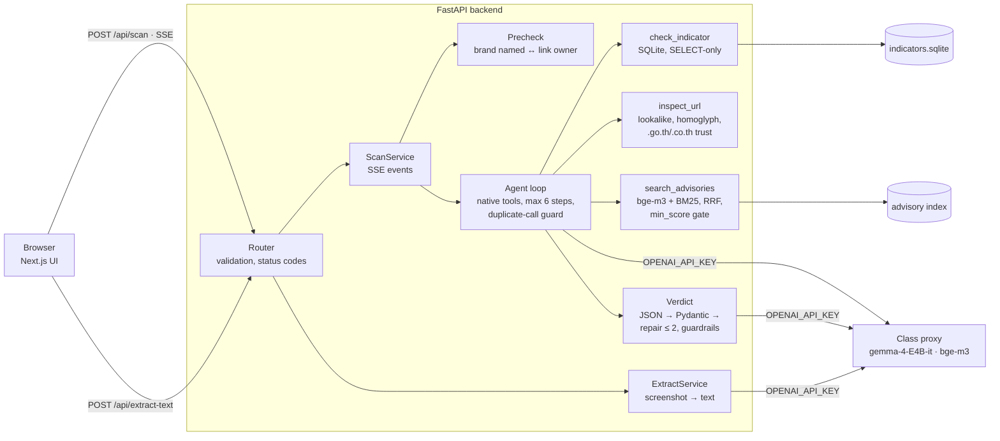

# ScamShield TH

An LLM agent that tells Thai users whether an SMS, LINE or email message is a scam. Paste a message (or a
screenshot) and it returns a validated verdict — scam type, risk level, red flags quoted from the message,
recommended actions — with citations to official Thai warnings.

Capstone for *Building LLM-Powered Applications* (KMITL). All LLM calls go through the class proxy
(`gemma-4-E4B-it` for chat and vision, `bge-m3` for embeddings), from the backend only.

## Results (held-out test set: 27 real messages — 17 scam, 10 genuine)

| System | Scams caught | Genuine flagged | Flag precision | Flag F1 | Type accuracy | Type macro-F1 |
|---|---|---|---|---|---|---|
| **Baseline** — zero-shot gemma, no tools, no retrieval | 17/17 | 3/10 | 0.850 | 0.919 | 0.778 | 0.667 |
| Agent, no RAG (URL / indicator tools + brand–link precheck) | 17/17 | **1/10** | **0.944** | **0.971** | 0.778 | 0.626 |
| **Agent + RAG** (what the app runs) | 17/17 | 2/10 | 0.895 | 0.944 | **0.815** | **0.740** |

"Flagged" = risk medium or high, i.e. what the user sees as a warning. Before the fixes described below, the agent
flagged **17 of 19** genuine messages (v1, `backend/eval/results/v1/`). With 27 messages, one message is ~4–10
points: read the counts, not just the ratios.

**Retrieval** (query = raw message, document-level, test split):

| Setting | Recall@3 | MRR | Genuine messages that retrieve any warning |
|---|---|---|---|
| Dense, no score gate (naive default) | 0.824 | 0.736 | 100 % |
| Dense / hybrid, `min_score` 0.40 (chosen on dev) | 0.824 | 0.736 / 0.723 | **90 %** |
| `min_score` 0.45 (previous default) | 0.765 | 0.677 | 90 % |

Hybrid BM25 + RRF beat dense on the dev split (R@3 0.773 vs 0.591) but tied on test — reported as found.

**Method.** The 53 real messages (`data/messages/real.jsonl`, from the author's phone, PII redacted) were first
scored as v1, which exposed the false positives. To fix them without contaminating the score, the set was split once
(seeded, stratified): every prompt change, brand-list entry and retrieval knob was chosen on `dev.jsonl`; `test.jsonl`
was scored once at the end.

**Known failures.** A genuine insurance-claim SMS with an unknown `.cc` link that asks for ID digits is flagged
high; a genuine loan-contract SMS is flagged once loan-scam advisories are retrieved; gambling ads are sometimes
typed as prizes. Details in the report.

## Architecture



- **Router → service → repository**: `app/api` (HTTP only) → `app/services` + `app/agent` → `app/repositories`
  (indicators, advisories, brands).
- **Structured output**: the proxy ignores `response_format`, so the verdict is prompted as JSON, parsed, validated by
  Pydantic (including cross-field rules: genuine ⇔ low risk; medium/high needs a red flag) and repaired at most twice.
  Red-flag quotes that are not verbatim in the message are dropped.
- **Guardrails in code**: hard tool evidence (lookalike or mixed-script domain, reported indicator) forces risk = high;
  citations come only from the retrieval trail and only back a warning; the user message is delimited as data.
- **Tools are allow-listed** and their arguments validated; `inspect_url` never fetches the page.

## Setup
Prerequisites: Python 3.12+, [uv](https://docs.astral.sh/uv/), Node 20+, pnpm.

```bash
cp backend/.env.example backend/.env          # backend only: put your course API key here
cp frontend/.env.example frontend/.env.local  # frontend: backend URL + mock switch (no secrets)

# backend
cd backend
uv sync
uv run python -m scripts.build_index      # chunk + embed the committed advisories (needs the proxy, ~1 min)
uv run uvicorn app.main:app --reload --port 8000
uv run pytest                             # offline tests, no proxy calls

# frontend (new terminal)
cd frontend
pnpm install
pnpm dev                                  # http://localhost:3000
```

## Data
| Path | What | Committed |
|---|---|---|
| `data/advisories/` | 26 official scam warnings: `sources.csv` (URLs), `raw/*.txt`, `advisories.jsonl` (metadata) | yes |
| `data/messages/` | 53 real messages (`real.jsonl`) split into `dev.jsonl` (tuning) and `test.jsonl` (reported) | yes |
| `data/indicators/` | `seed.csv` official domains + hotlines, `brands.csv` brand names ↔ official domains | yes |
| `data/index/` | vector index + SQLite, rebuilt by `scripts.build_index` | no (generated) |

Re-download the corpus with `uv run --group fetch python -m scripts.fetch_advisories` (pages change; the committed
text is what the numbers were measured on).

## Reproducing the numbers
```bash
cd backend
uv run python -m eval.run_eval --split test --mode baseline      # zero-shot gemma, no tools, no retrieval
uv run python -m eval.run_eval --split test --mode agent_norag   # + inspect_url / check_indicator / precheck
uv run python -m eval.run_eval --split test --mode agent         # + search_advisories (RAG)
uv run python -m eval.run_retrieval --split test [--size 300]    # dense vs BM25 vs hybrid, min_score sweep
```
All runs use `temperature=0`; the proxy is not perfectly deterministic, so a rerun can move a message or two.
The proxy caps tokens per short window — the eval waits and retries on HTTP 429. Per-item results and logs are in
`backend/eval/results/`.

## Limitations
- 53 labelled messages from one person's phone; some labels rest on the recipient's judgement (`label_basis`).
- No database of reported scam numbers/links yet — `check_indicator` knows official channels only.
- `brands.csv` covers 30 brands; a genuine message from an unlisted brand on an unknown domain is judged on content alone.
- Screenshot reading (gemma vision) misreads some Thai words, so the text is shown for review before scanning.
